<div align="center">


# MedSync

**A lab uploads a scan. AI gives a first reading in seconds. The doctor reviews it. The patient gets the answer.**

One secure platform for patients, doctors, laboratories and admins, with an X-ray and MRI model ensemble,<br/>
AI reading of lab reports, consent-based care, chat, video consultations and digital prescriptions.

[](https://nextjs.org/)
[](https://react.dev/)
[](https://www.typescriptlang.org/)
[](https://supabase.com/)
[](https://fastapi.tiangolo.com/)
[](https://pytorch.org/)
[](https://ai.google.dev/)

[Why](#why-medsync) · [How it works](#how-a-report-moves) · [Features](#features) · [The AI](#the-ai) · [Security](#security-and-privacy) · [Architecture](#architecture) · [Run it](#run-it-locally) · [Tests](#tests) · [Team](#team)

<br/>

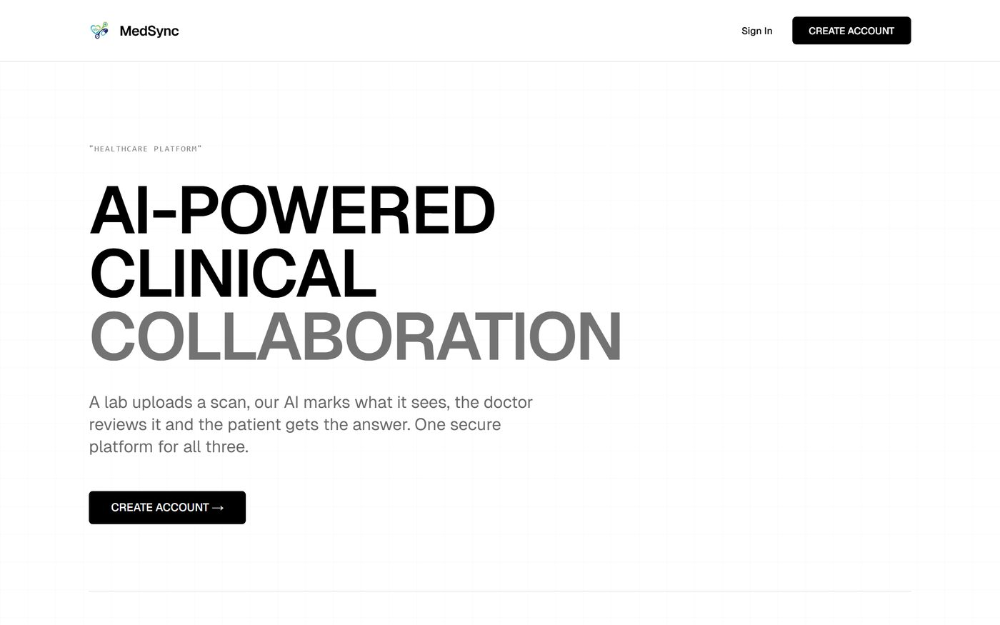

</div>

<br/>

## Why MedSync

A diagnostic report usually involves three people: the laboratory that runs the test, the doctor who reads it, and the patient who has to understand it. In practice the report travels between them on paper, by e-mail or over messaging apps. That causes four problems:

- **Fragmented hand-offs.** There is no shared record, so files get delayed or lost.
- **Late first reading.** A scan waits until a doctor is free, even when an automated first look could flag an urgent finding.
- **Unexplained results.** Patients receive reports full of technical terms and have no secure way to ask about them.
- **Uncontrolled access.** Health data moves over channels where nobody can say who has seen it.

MedSync puts all three people around **the same report**. An AI reading is ready the moment the report is uploaded. The doctor stays in charge of what the patient finally sees.

## How a report moves

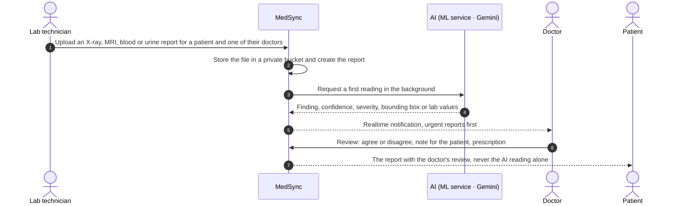

## Features

<table>
<tr>
<td width="50%" valign="top">

### Patients
- **Find a doctor** by what they treat and send a consultation request. You can have several doctors and **end care at any time**, which removes that doctor's access to your records.
- **Reports in plain language**, each with the doctor's review. The AI reading is shown only next to that review.
- **Health record**: allergies, medicines and conditions, plus a timeline of reports, reviews, prescriptions and consultations.
- **Chat, video consultations** and an **AI health assistant**.
- **Confirm or decline** appointments that a doctor proposes.

</td>
<td width="50%" valign="top">

### Doctors
- **A dashboard that puts urgent reports first.**
- **AI first reading** with a bounding box drawn on the radiograph.
- **Structured review**: a verdict on the AI reading, a note for the patient (typed or dictated), a photo of a handwritten note, and a private note for the patient's other doctors.
- **Digital prescriptions** that can be printed and show the doctor's registration number.
- **Patient record, schedule, chat and peer-to-peer video**.

</td>
</tr>
<tr>
<td width="50%" valign="top">

### Laboratories
- **Upload a report** for a patient and choose which of that patient's doctors receives it.
- **Automatic AI reading**: scans go to the ML service and blood or urine reports go to Gemini.
- **Samples and imaging** pages, with *Send to doctor* for any scan.

</td>
<td width="50%" valign="top">

### Admins
- **Verify doctors and labs** from their medical council, registration number and qualification, or let them join with **single-use invite codes**.
- **See every account and its status.** Admins never see medical records.
- **Every decision is logged.** Closed accounts are purged once their retention period ends.

</td>
</tr>
</table>

<table>
<tr>
<td width="50%">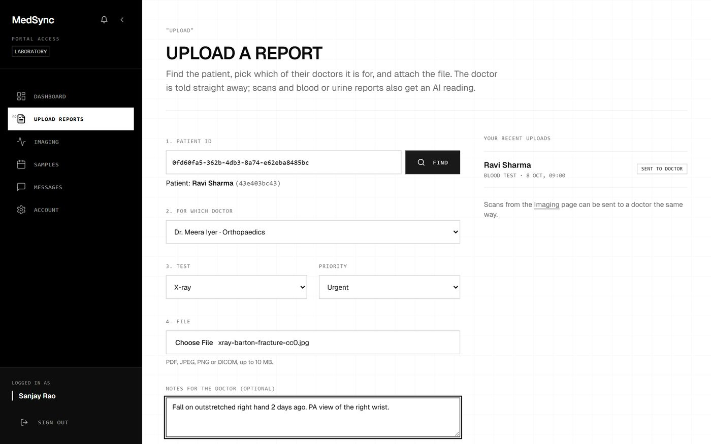<p align="center"><sub><b>Lab</b> · upload a report for a patient's doctor</sub></p></td>
<td width="50%">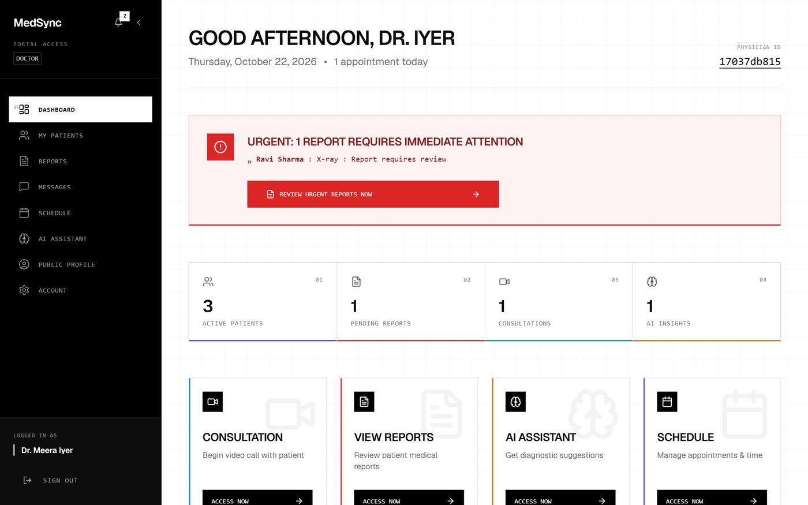<p align="center"><sub><b>Doctor</b> · urgent reports first</sub></p></td>
</tr>
<tr>
<td width="50%">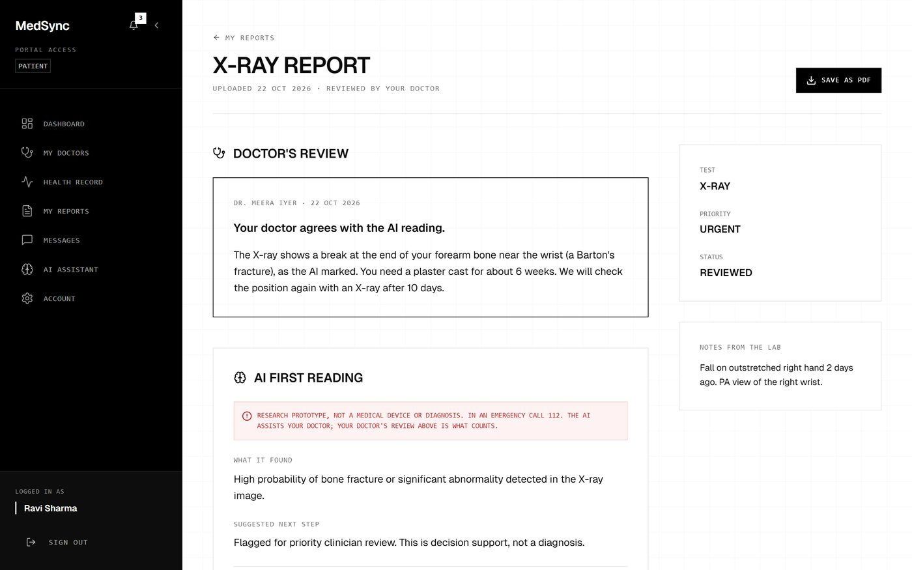<p align="center"><sub><b>Patient</b> · the report with the doctor's review</sub></p></td>
<td width="50%">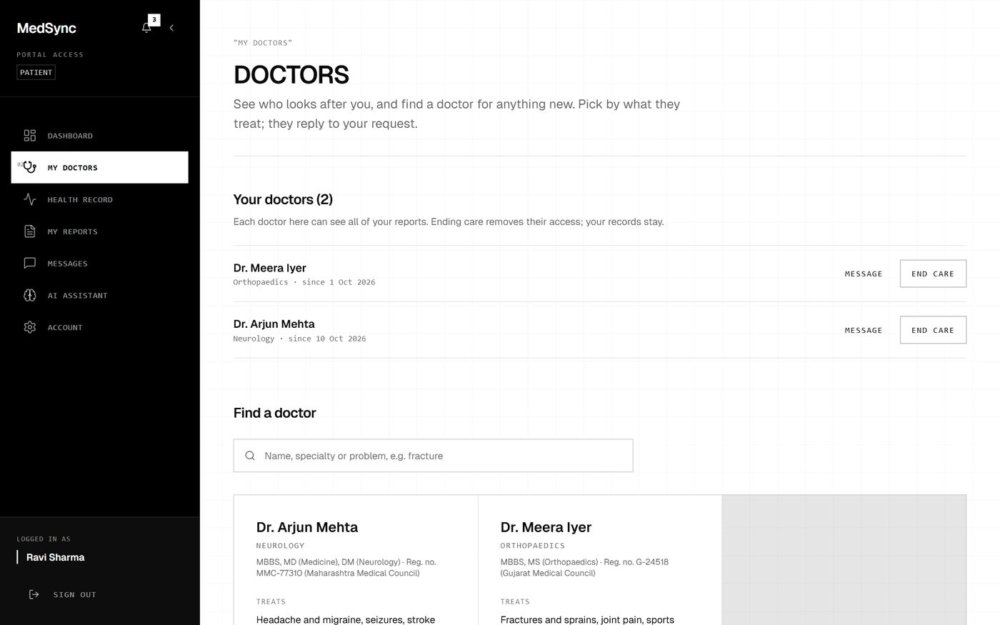<p align="center"><sub><b>Patient</b> · find a doctor, end care at any time</sub></p></td>
</tr>
<tr>
<td width="50%">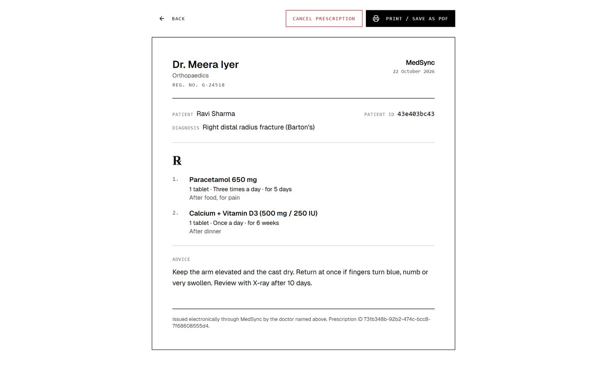<p align="center"><sub><b>Doctor</b> · printable digital prescription</sub></p></td>
<td width="50%">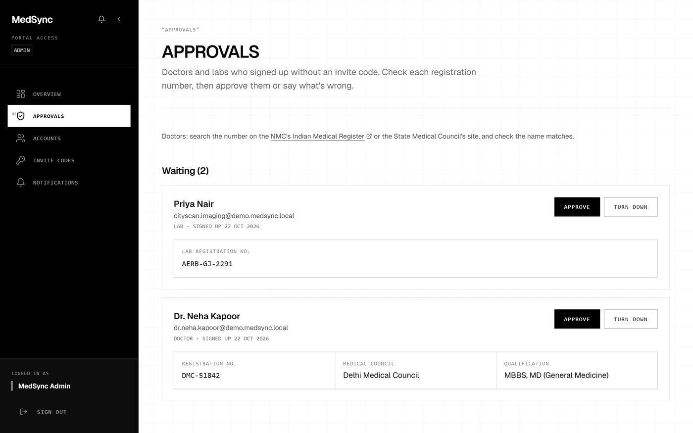<p align="center"><sub><b>Admin</b> · verify registration details</sub></p></td>
</tr>
</table>

## The AI

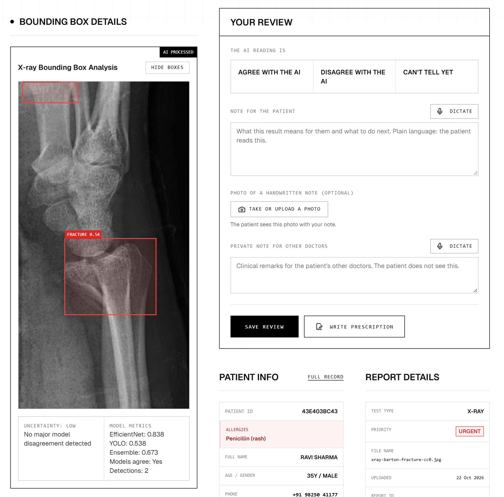

**X-ray fracture detection.** Two models read every radiograph, and the service combines their scores:

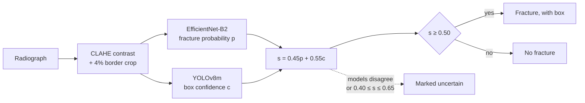

| Model | Task | Validation |
|---|---|---|
| EfficientNet-B2 (260 px) | Is there a fracture? | accuracy **0.852**, AUC **0.913** |
| YOLOv8m (640 px) | Where is it? | precision **0.897**, recall **0.867**, mAP@50 **0.930**, mAP@50–95 **0.537** |

An X-ray reading takes **0.20 s** (median) on a CPU, with no GPU.

**Brain MRI.** A Keras CNN at 150 × 150 px flags likely tumours.

**Blood and urine reports.** Gemini 2.5 Flash (falling back to 2.0 Flash) turns the report into a table of every test value, with its reference range, a low/high flag and a plain-language summary.

**The doctor is always in the loop.** Every AI reading goes to the patient's doctor first. The patient sees it only together with the doctor's review.

<br clear="right"/>

## Security and privacy

| | |
|---|---|
| **Row-level security everywhere** | All 26 tables have row-level security, enforced by 50 policies. **340 pgTAP assertions** check who can read and write what. |
| **Private files** | Reports, imaging and handwritten notes live in private storage buckets and are served through signed links that expire after 5 minutes. |
| **Roles the user cannot change** | A database trigger writes the role to `app_metadata` at sign-up. Users cannot edit that field, and the middleware authorizes every dashboard from it. |
| **Verified practitioners** | Doctors and labs give their registration details at sign-up and are approved by an admin, following India's Telemedicine Practice Guidelines (2020). |
| **Audit trail** | Every time a doctor opens a report, and every admin decision, is logged. |
| **Rate limits** | Upstash Redis allows 20 auth requests and 60 API requests per minute per client. |
| **Locked-down ML service** | The ML service only answers callers that present a shared internal secret. |
| **Closing an account** | Anyone can close their account. Medical records are kept for 3 years after the last activity, as Indian medical-record rules require, then deleted. |
| **Video** | Calls are peer-to-peer over WebRTC, signalled through Supabase Realtime, and never recorded. |

## Architecture

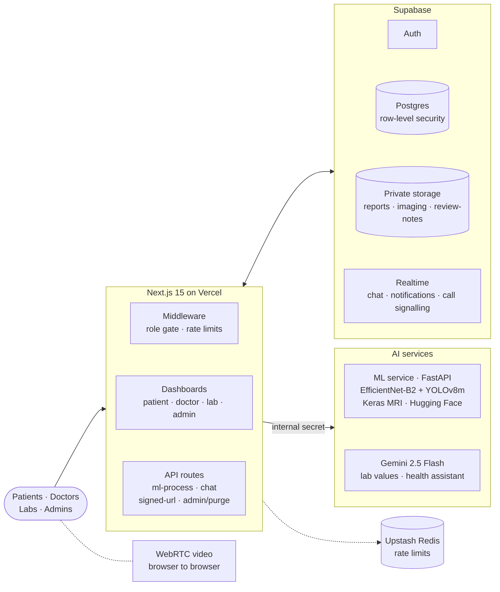

| Layer | Technology |
|---|---|
| Web app | Next.js 15.5 (App Router), React 19, TypeScript, Tailwind CSS, shadcn/ui |
| Backend | Supabase: Postgres with row-level security, Auth, Storage, Realtime |
| AI | PyTorch (EfficientNet-B2, YOLOv8m), Keras, FastAPI, Google Gemini |
| Video | WebRTC (peer-to-peer) with Supabase Realtime signalling |
| Platform | Vercel, Hugging Face Spaces (Docker), Upstash Redis |
| Quality | Vitest, Playwright, pytest, pgTAP, GitHub Actions |

## Run it locally

**You need** Node.js 20+, pnpm 10 (`corepack enable`), Docker (for local Supabase) and Python 3.12 (for the ML service).

```bash
git clone https://github.com/airy-suit8/MedSync.git
cd MedSync
pnpm install

pnpm exec supabase start        # Postgres, Auth, Storage and Realtime in Docker; applies every migration
cp .env.example .env.local      # fill in the URL and keys printed by `pnpm exec supabase status`
pnpm dev                        # http://localhost:3000
```

**The ML service** (optional; without it, uploads still work but scans get no AI reading):

```bash
cd ml-service
python -m venv .venv
source .venv/bin/activate       # Windows: .venv\Scripts\activate
pip install -r requirements.txt
python serve_models.py          # http://localhost:8000
```

The model weights are not stored in this repository. Put them at `ml-service/models/best_effnet_v4.pth`, `ml-service/models/best.pt` and `ml-service/brain_tumor_model.pkl`. `GET /health` reports which models have loaded.

**Your first admin.** Sign up, then run this in the Supabase SQL editor:

```sql
select public.promote_to_admin('you@example.com');
```

<details>
<summary><b>Environment variables</b></summary>
<br/>

| Variable | What it is for |
|---|---|
| `NEXT_PUBLIC_SUPABASE_URL`, `NEXT_PUBLIC_SUPABASE_ANON_KEY` | The Supabase project the browser talks to |
| `SUPABASE_SERVICE_ROLE_KEY` | Server-only: signed file links and admin purges |
| `GEMINI_API_KEY` | Lab-report reading and the patient's AI assistant |
| `ML_SERVICE_URL` | Where the ML service runs (`http://localhost:8000`, or your Space URL) |
| `INTERNAL_API_KEY` | Shared secret between the app and the ML service |
| `UPSTASH_REDIS_REST_URL`, `UPSTASH_REDIS_REST_TOKEN` | Rate limiting (required in production) |
| `NEXT_PUBLIC_SITE_URL` | Public address for link previews and the sitemap (on Vercel it defaults to the production domain) |

</details>

<details>
<summary><b>Deploying</b></summary>
<br/>

1. **Database:** run `supabase link` to connect your project, then `supabase db push` to apply the migrations.
2. **ML service:** push `ml-service/` to a Docker Space on Hugging Face, add the weights, and set `INTERNAL_API_KEY` as a Space secret.
3. **Web app:** import the repository into Vercel and set the environment variables above.

</details>

<details>
<summary><b>Project structure</b></summary>
<br/>

```
app/            Routes: landing, sign-in and sign-up, the four dashboards, API routes
components/     UI (shadcn/ui) and medical components: scan viewer, review panel, video call
hooks/          Shared React hooks
lib/            Supabase clients, validation, AI helpers, shared constants
middleware.ts   Role-based route protection and rate limits
ml-service/     FastAPI X-ray and MRI service (Dockerfile for Hugging Face Spaces)
supabase/       Migrations, pgTAP tests, auth e-mail templates
tests/          Unit, integration and Playwright end-to-end tests
```

</details>

## Tests

| Layer | Tool | Size | Command |
|---|---|---|---|
| Database security | pgTAP | 340 assertions in 14 files | `pnpm test:pgtap` |
| Unit | Vitest | 169 tests in 21 files | `pnpm test:unit` |
| ML service | pytest | 27 tests | `pnpm test:ml` |
| Integration | Vitest against local Supabase | 2 tests | `pnpm test:integration` |
| End-to-end | Playwright | 10 flows, run at desktop and mobile size | `pnpm test:e2e` |

GitHub Actions runs lint, the type check, a production build and every test layer on each push and pull request. The database, integration and end-to-end tests need local Supabase (`pnpm exec supabase start`).

## Team

| | |
|---|---|
| **Tirth Ganatra** | [@airy-suit8](https://github.com/airy-suit8) |
| **Evan Gregor** | [@EvanGregor](https://github.com/EvanGregor) |

MedSync began as a 36-hour hackathon prototype, and the team grew it into a complete platform.

## Disclaimer

MedSync is an academic project and is not a certified medical device. AI readings are decision support, not a diagnosis. A registered doctor reviews every reading before the patient sees it.

<div align="center">
<br/>
<br/>
<sub>Built by the MedSync team</sub>
</div>
