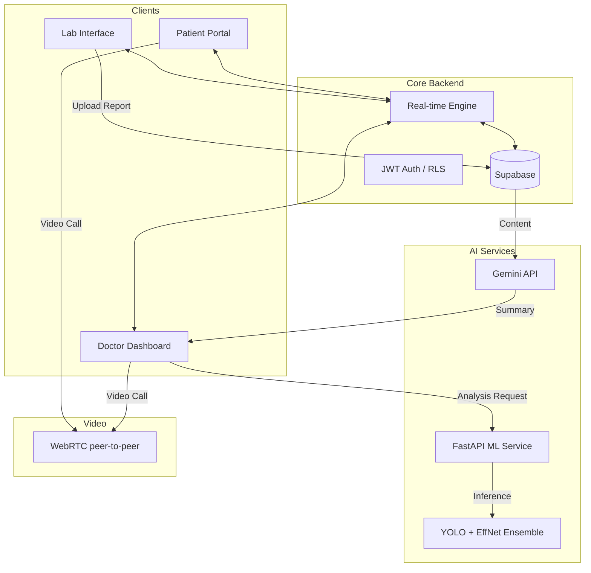

# 🏥 MedSync

<div align="center">
  
  <h3>AI-Powered Clinical Collaboration Platform</h3>
  <p><i>Bridging the gap between patients, doctors, and lab technicians through real-time intelligence.</i></p>

  [](https://nextjs.org/)
  [](https://supabase.com/)
  [](https://deepmind.google/technologies/gemini/)
  [](https://webrtc.org/)
</div>

---

## 🌟 Overview

**MedSync** is a revolutionary healthcare communication and diagnostic platform built during the **Parul University AI/ML Hackathon 2.0**. It streamlines the medical workflow by integrating real-time communication with advanced AI-driven clinical decision support. 

From automated **MRI Brain Tumor detection** to **X-ray fracture analysis**, MedSync empowers healthcare providers with the tools they need to deliver faster, more accurate care.

## ✨ Key Features

### 🤖 Clinical Intelligence (AI/ML)
- **Advanced X-ray Ensemble**: Combines **EfficientNet** and **YOLOv8** for bone fracture detection with confidence scoring and a box around the finding.
- **MRI Brain Tumor Detection**: Keras-based deep learning model for rapid identification of neural abnormalities.
- **Lab Value Reading**: Google Gemini reads blood and urine reports into a table of values with their reference ranges for the doctor.
- **Doctor in the Loop**: Every AI reading goes to the patient's doctor first; patients see it only with the doctor's review.

### 🔄 Real-time Ecosystem
- **Instant Messaging**: Chat between Doctors, Patients, and Lab Technicians, encrypted in transit.
- **Live Sync Dashboards**: Role-specific interfaces that update in real-time via Supabase WebSockets, with a notifications inbox for every role.
- **Video Consultations**: Peer-to-peer **WebRTC** calls, signalled over Supabase Realtime and never recorded.

### 🩺 Care Workflow
- **Find a Doctor**: Patients search doctors by what they treat and send consultation requests; a patient can have several doctors and end care at any time.
- **Doctor Reviews**: A verdict on the AI reading, a note for the patient (with dictation), a photo of a handwritten note, and a private note for the patient's other doctors.
- **Digital Prescriptions**: Written by the doctor from a review, a consultation or the patient record; printable, with the doctor's registration number.
- **Health Record**: The patient's health profile (allergies, medicines, conditions) and a timeline of reports, reviews, prescriptions and consultations.

### 🗂️ Administration
- **Verified Doctors and Labs**: Doctors give their medical council, registration number and qualification at sign-up; an admin approves them, or they join with a single-use invite code.
- **Admin Dashboard**: Approvals, every account and its status, and invite codes. Admins never see medical records.
- **Closing an Account**: Anyone can close their account; medical records are kept for 3 years after the last activity, as Indian medical record rules require, then deleted.

### 🛡️ Enterprise-Grade Security
- **Role-Based Access Control (RBAC)**: Strict permission boundaries for different user types.
- **Secure Architecture**: Row Level Security (RLS) and JWT authentication ensure data privacy.
- **Audit Trails**: Every time a doctor opens a report, and every admin decision, is logged.

---

## 🛠️ Technology Stack

| Category | Technology |
| --- | --- |
| **Frontend** | Next.js 15, React 19, TypeScript |
| **Styling** | Tailwind CSS, shadcn/ui |
| **Backend** | Supabase (PostgreSQL, Auth, Real-time, Storage) |
| **AI/ML** | Google Gemini API, PyTorch, YOLOv8, Keras |
| **Video/Comm** | WebRTC (peer-to-peer), Supabase Realtime signalling |
| **ML Serving** | FastAPI, Uvicorn, SlowAPI (Rate Limiting) |

---

## 📐 System Architecture



---

## 🚀 Deep Dive: ML Service

The MedSync ML Service is a high-performance FastAPI application designed for medical imaging:

- **X-ray Pipeline**: Uses **CLAHE (Contrast Limited Adaptive Histogram Equalization)** for image enhancement before passing it to an ensemble of EfficientNet (classification) and YOLO (localization).
- **MRI Pipeline**: A specialized Keras model trained on thousands of scans to detect mass lesions and tumors.
- **Security**: Protected via `X-Internal-Secret` headers and rate-limited to ensure stability.

---

## 🏁 Getting Started

### Prerequisites
- Node.js 20+ and pnpm 10 (`corepack enable` installs the version pinned in `package.json`)
- Python 3.12+ (for ML Service)
- Supabase Project
- Docker (only for the local Supabase used by integration, pgTAP and E2E tests)

### Installation

1. **Clone & Install Frontend:**
   ```bash
   git clone https://github.com/EvanGregor/MedSync.git
   cd MedSync
   pnpm install
   ```

2. **Setup ML Service** (in a virtual environment):
   ```bash
   cd ml-service
   python -m venv .venv
   .venv\Scripts\activate         # macOS/Linux: source .venv/bin/activate
   pip install -r requirements.txt
   python serve_models.py         # serves on http://localhost:8000
   ```

3. **Environment Variables:**
   Copy `.env.example` to `.env.local` in the root and fill in the values. `ML_SERVICE_URL` must point at the ML service (`http://localhost:8000` locally). The ML service reads `INTERNAL_API_KEY` from the same file, so both sides share one secret.

4. **Run Development Server:**
   ```bash
   pnpm dev
   ```

### Running Tests
```bash
pnpm test:unit        # Vitest unit tests
pnpm test:ml          # pytest; activate ml-service/.venv first and run
                      # pip install pytest httpx pytest-mock pytest-cov
pnpm test:integration # needs local Supabase (Docker): pnpm exec supabase start
pnpm test:pgtap       # RLS policy tests, also needs local Supabase
pnpm test:e2e         # Playwright; run pnpm exec playwright install first
```

---

## 🏆 Hackathon Credits

Built in 36 hours for **Parul University AI/ML Hackathon 2.0**.

- **Infra**: Supabase, Vercel
- **AI**: Google Gemini
- **Video**: WebRTC

---

<div align="center">
  <b>Professional. Precise. Human.</b><br/>
  <sub>v2.0.25 • MedSync Team</sub>
</div>
